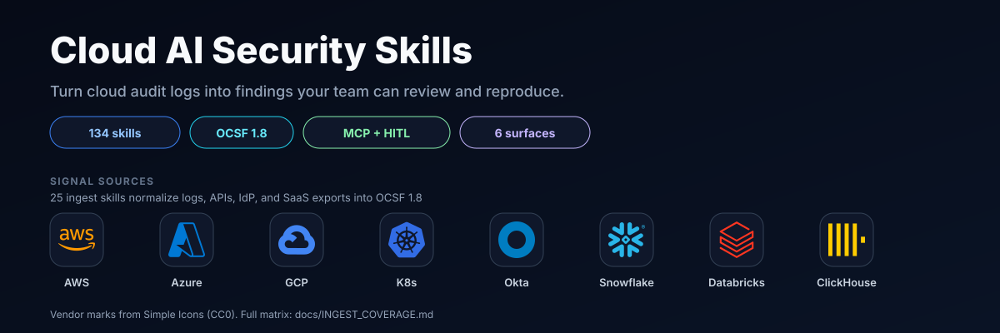
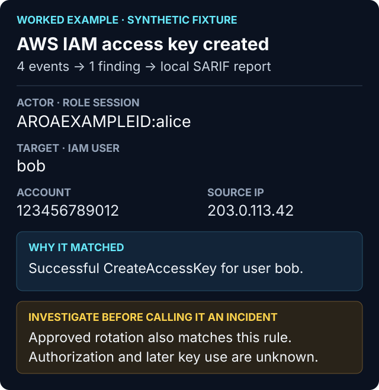
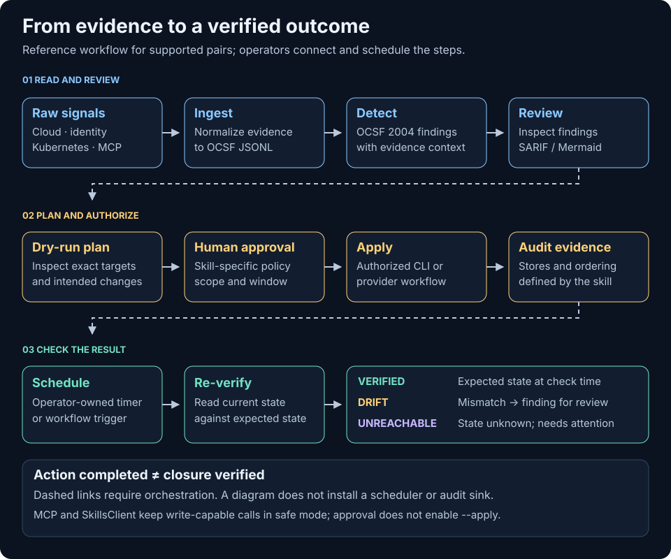
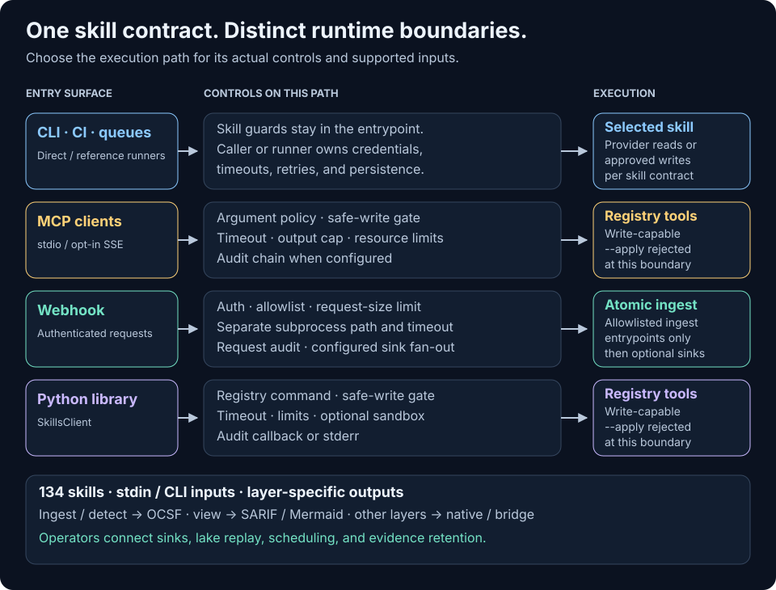
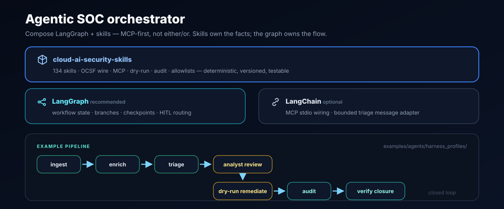
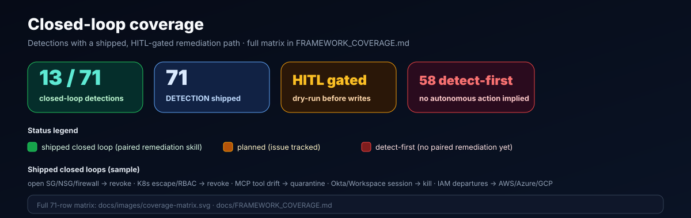

<p align="center">
  <a href="https://github.com/msaad00/cloud-ai-security-skills/actions/workflows/ci.yml?query=branch%3Amain"></a>
  <a href="CHANGELOG.md"></a>
  <a href="LICENSE"></a>
  <a href="https://www.python.org/downloads/"></a>
  <a href="https://schema.ocsf.io/1.8.0"></a>
  <a href="docs/COVERAGE_SNAPSHOT.md"></a>
</p>

<p align="center"><strong>Turn cloud audit logs into explainable security findings your team can review and reproduce.</strong> 134 deterministic security skills for cloud &amp; AI infrastructure, with local CLI pipelines, MCP tools, and supported remediation behind human approval gates.</p>

## Quickstart

No cloud credentials needed — the demo replays a synthetic CloudTrail fixture.

```bash
git clone https://github.com/msaad00/cloud-ai-security-skills.git
cd cloud-ai-security-skills
uv sync --frozen             # install uv first: https://docs.astral.sh/uv/
uv run make demo             # ingest -> detect -> SARIF, then prints the findings
```

**Expected result:** four input events produce one finding, `AWS IAM access key created`,
with SARIF rule `T1098`. The report is written to
`$TMPDIR/cloud-security-demo.sarif` (`/tmp` when `TMPDIR` is unset).

<picture>
  <source media="(max-width: 600px)" srcset="docs/images/access-key-walkthrough-mobile.svg">
  
</picture>

This is an annotated example of the emitted finding, not an application screen.
A legitimate key rotation also matches this rule; the finding alone does not
establish compromise. **[Follow the investigation](docs/WALKTHROUGH.md)** to
inspect the input, reproduce the result, check nonmatches, and decide what to
investigate next.

The same pipeline, spelled out — each stage is a standalone skill joined by a Unix pipe:

```bash
# Run this pipeline in Bash; propagate errors from every stage.
set -o pipefail
uv run python skills/ingestion/ingest-cloudtrail-ocsf/src/ingest.py \
       skills/detection-engineering/golden/cloudtrail_raw_sample.jsonl \
  | uv run python skills/detection/detect-aws-access-key-creation/src/detect.py \
  | uv run python skills/view/convert-ocsf-to-sarif/src/convert.py \
  > findings.sarif
```

Drop the last stage to see the raw OCSF Detection Finding. More paths: [`docs/QUICKSTART.md`](docs/QUICKSTART.md) · cloud SDK groups: [`docs/INSTALL.md`](docs/INSTALL.md).

| Need | Read |
|---|---|
| Understand the demo | [`docs/WALKTHROUGH.md`](docs/WALKTHROUGH.md) |
| Pick a skill | [`docs/SKILL_INDEX.md`](docs/SKILL_INDEX.md) |
| Wire an agent (MCP) | [`docs/AGENT_QUICKSTART.md`](docs/AGENT_QUICKSTART.md) |
| Ship a SOC workflow | [`docs/HARNESS.md`](docs/HARNESS.md) |
| Map to frameworks | [`docs/FRAMEWORK_COVERAGE.md`](docs/FRAMEWORK_COVERAGE.md) |
| Browse every doc | [`docs/README.md`](docs/README.md) |

## What this is

- **Deterministic skills, not prompts.** Each skill has an explicit contract, Python source, tests, and official references. Ingest and detect exchange JSONL; views produce SARIF or Mermaid, and discovery and evaluation use their documented formats. Detection rules produce findings from input evidence; models can orchestrate the workflow.
- **A real contract on the wire.** Ingest and detect speak [OCSF 1.8](skills/detection-engineering/OCSF_CONTRACT.md); detections are Detection Finding `2004` with MITRE ATT&CK / ATLAS mappings, frozen by golden fixtures so a refactor that changes the shape fails CI.
- **Writes are gated, audited, and re-verified.** Remediation defaults to dry-run. Each skill defines its approval, scope, audit stores, and verification path. A successful action is distinct from a later verification result; scheduling and evidence retention need operator configuration. Policy: [`docs/HITL_POLICY.md`](docs/HITL_POLICY.md).
- **One codebase, every surface.** CLI, CI, MCP, the Python library, and reference runners reuse the shipped entrypoints. Their routing, credentials, audit, and execution limits differ; choose a surface for the workflow you need.

## How the loop closes



Details: [`docs/REMEDIATION_VERIFICATION.md`](docs/REMEDIATION_VERIFICATION.md) (VERIFIED / DRIFT / UNREACHABLE) · [`docs/MCP_AUDIT_CONTRACT.md`](docs/MCP_AUDIT_CONTRACT.md) (HMAC-chained MCP audit log) · [`docs/DATA_FLOW.md`](docs/DATA_FLOW.md).

## Skills at a glance

| Layer | Count | Output |
|---|---:|---|
| Ingest | 25 | OCSF 1.8 |
| Discover | 5 | native / bridge JSON |
| Detect | 71 | OCSF Detection Finding 2004 |
| Evaluate | 12 | compliance result |
| Remediate | 12 | audited action trail |
| View | 2 | SARIF · Mermaid |
| Output | 3 | S3 · Snowflake · ClickHouse |
| Sources | 4 | warehouse query adapters |

**134 shipped skills.** Live counts: [`docs/COVERAGE_SNAPSHOT.md`](docs/COVERAGE_SNAPSHOT.md). Vendor ingest matrix: [`docs/INGEST_COVERAGE.md`](docs/INGEST_COVERAGE.md). Why not roll your own: [`docs/WHY.md`](docs/WHY.md).

## Architecture



The skill contract is shared; runtime protections are surface-specific. MCP
rejects write-capable `--apply` calls at its boundary, even with approval metadata.
The Python library also keeps writes in safe mode. The webhook accepts only
allowlisted atomic ingesters and can forward results to configured sinks.
Approved remediation uses the skill's documented CLI or provider workflow.
See the [runtime boundary table](docs/ARCHITECTURE.md#runtime-boundaries).

`persistent` means a skill can run inside a long-lived workflow. It does not
install a scheduler: the repo ships reference runners, and operators configure
queues, credentials, storage, monitoring, and re-verification.

Deeper reads: [`docs/ARCHITECTURE.md`](docs/ARCHITECTURE.md) · [`docs/SKILL_CONTRACT.md`](docs/SKILL_CONTRACT.md) · [`docs/diagrams/`](docs/diagrams/)

Deployment case study: [GCP event delivery and replay suppression](docs/GCP_RUNNER_CASE_STUDY.md).

Design rationale: [`docs/DESIGN_DECISIONS.md`](docs/DESIGN_DECISIONS.md) · [`SECURITY_BAR.md`](SECURITY_BAR.md). Tests and CI gates: [`docs/CI_WORKFLOW.md`](docs/CI_WORKFLOW.md) · [`docs/TESTING.md`](docs/TESTING.md).

**Invariant:** skills own facts, schemas, mappings, confidence, and audit. Orchestrators own workflow state and model choice only.

## Agent and MCP integrations

| Client | Doc |
|---|---|
| Claude Code | [`.mcp.json`](.mcp.json) |
| Claude Desktop · Cursor · Windsurf · Codex · Cortex · Zed | [`docs/integrations/`](docs/integrations/) |
| Agent SDK · LangGraph harness | [`examples/agents/`](examples/agents/) |
| Webhook receiver | [`runners/webhook-receiver/`](runners/webhook-receiver/) |
| Python library | [`skills/_shared/library.py`](skills/_shared/library.py) |

Presets: [`presets/`](presets/) · workflows: [`examples/workflows/`](examples/workflows/)

<details>
<summary><b>Workflow frameworks (LangGraph / LangChain)</b> — compose, don't replace</summary>

LangGraph owns multi-step workflow state, checkpoints, and HITL interrupts; this repo owns the facts, mappings, approval gates, and audit. MCP is the tool surface between them. The reference harness ([`langgraph_security_graph.py`](examples/agents/langgraph_security_graph.py), [`harness_profiles/`](examples/agents/harness_profiles/)) runs ingest → enrich → triage → analyst review → dry-run remediate → audit → verify closure. LangChain is optional glue ([`langchain_mcp_security_agent.py`](examples/agents/langchain_mcp_security_agent.py), [`harness_adapters.py`](examples/agents/harness_adapters.py)); wrapping skills as LCEL tools is a documented anti-pattern ([`examples/agents/README.md`](examples/agents/README.md)). Full guide: [`docs/HARNESS.md`](docs/HARNESS.md).



</details>

## Data lakes

Closed-loop lake packs for operator-owned warehouses:

- **ClickHouse** — [`docs/CLICKHOUSE_DATA_LAKE.md`](docs/CLICKHOUSE_DATA_LAKE.md) · [`packs/clickhouse/`](packs/clickhouse/)
- **Snowflake** — [`docs/SNOWFLAKE_DATA_LAKE.md`](docs/SNOWFLAKE_DATA_LAKE.md) · [`packs/snowflake/`](packs/snowflake/)

Write with `sink-*-jsonl` and replay with `source-*-query`. Route audit records
through a configured sink when composing a closed loop; persistence is not
automatically enabled by invoking a detector.

## Trust · compliance · more

| Topic | Doc |
|---|---|
| Trust posture | [`SECURITY.md`](SECURITY.md) · [`SECURITY_BAR.md`](SECURITY_BAR.md) |
| Fixture provenance | [Synthetic scenarios](skills/detection-engineering/golden/README.md) · [Captured-traffic evidence status](skills/detection-engineering/captured/README.md) |
| MCP audit contract | [`docs/MCP_AUDIT_CONTRACT.md`](docs/MCP_AUDIT_CONTRACT.md) |
| Framework mappings | [`docs/FRAMEWORK_MAPPINGS.md`](docs/FRAMEWORK_MAPPINGS.md) |
| Security grades | [`docs/SECURITY_GRADES.md`](docs/SECURITY_GRADES.md) |
| Install | [`docs/INSTALL.md`](docs/INSTALL.md) |
| Supply chain | [`docs/SUPPLY_CHAIN.md`](docs/SUPPLY_CHAIN.md) |

<details>
<summary><b>Closed-loop coverage</b> — detections with paired remediation</summary>



Full per-skill matrix: [`docs/FRAMEWORK_COVERAGE.md`](docs/FRAMEWORK_COVERAGE.md) · [`docs/images/coverage-matrix.svg`](docs/images/coverage-matrix.svg)

</details>

<details>
<summary><b>Layer output formats</b> — when OCSF vs native</summary>

| Layer | Default | Why |
|---|---|---|
| Ingest · Detect | OCSF 1.8 | SIEM interop |
| Evaluate | native | ops dashboards |
| Discover | native / CycloneDX | not an event stream |
| Remediate | native | state + audit trail |
| View | SARIF / Mermaid | human review |
| Output | pass-through | producer format |

</details>

## Roadmap · contributing

Roadmap: [`docs/ROADMAP.md`](docs/ROADMAP.md) · issues [#253](../../issues/253) · [#254](../../issues/254) · [#255](../../issues/255). PRs: [`CONTRIBUTING.md`](CONTRIBUTING.md). Apache 2.0.

Companion scanner: [`agent-bom`](https://github.com/msaad00/agent-bom).
